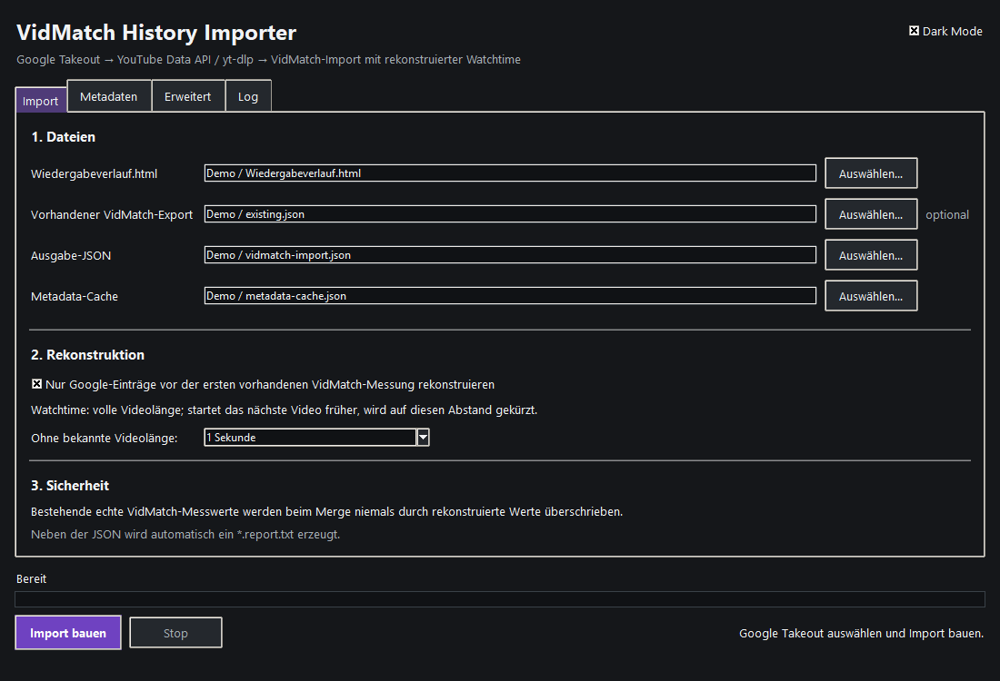
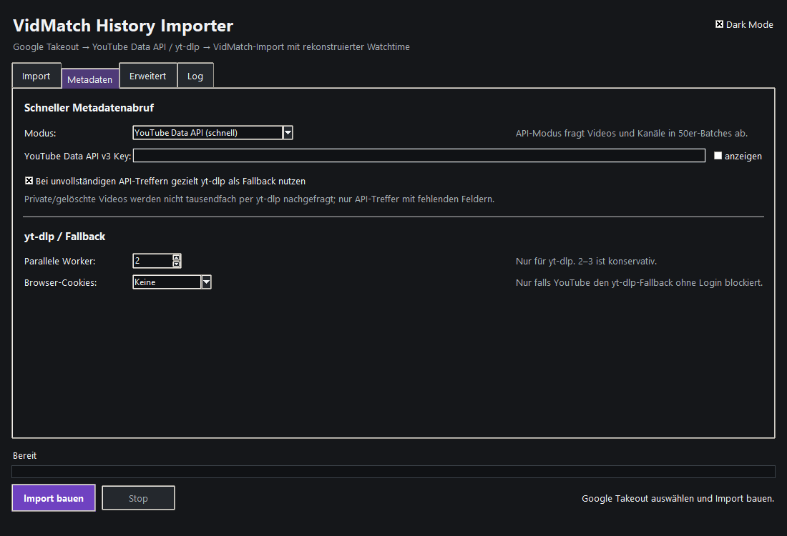
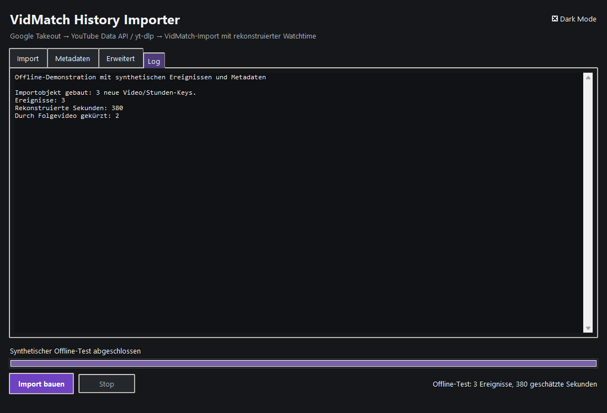

# VidMatch History Importer by JStudios

[](https://jstudios.pages.dev/projects/vidmatch-history-importer/)
[](https://www.python.org/)
[](https://docs.python.org/3/library/tkinter.html)
[](https://jstudios.pages.dev/projects/vidmatch-history-importer/)
[](https://jstudios.pages.dev/projects/vidmatch-history-importer/)
[](LICENSE)

**Historische YouTube-Aufrufe für VidMatch aufbereiten.**

[Projektseite](https://jstudios.pages.dev/projects/vidmatch-history-importer/) · [Lizenz](LICENSE) · 1.2 · Bestandsprojekt

Ein Desktop-Werkzeug zur Überführung von Google-Takeout-Wiedergabeverläufen in ein VidMatch-kompatibles JSON-Format. Es ergänzt Metadaten und rekonstruiert geschätzte Wiedergabezeiten.

## Hintergrund

Ein Takeout-Export enthält Video-Aufrufe, aber normalerweise keine tatsächlich gemessene Wiedergabedauer pro Aufruf. Der Importer verbindet diese historischen Einträge mit Videometadaten, ohne bestehende echte VidMatch-Messwerte zu überschreiben. Die geschätzte Watchtime bleibt eine Rekonstruktion und wird nicht als gemessene Telemetrie ausgegeben.

## Vorschau

### Import konfigurieren



*Originaloberfläche mit Beispielpfaden.*

## Funktionsumfang

### Takeout-Parser

Liest das unterstützte deutsche HTML-Format, filtert erkannte Werbeeinträge und sortiert die Ereignisse chronologisch. Zeitangaben werden auf CET/CEST des jeweiligen Ereignisdatums umgerechnet.

### Metadaten mit Cache

YouTube Data API v3 fragt Video- und Kanalinformationen in Batches ab. yt-dlp steht alternativ oder als gezielter Fallback zur Verfügung. Metadaten werden lokal gecacht.

### Konservative Rekonstruktion

Bekannte Videolänge als Ausgangswert, begrenzt durch den Abstand zum nächsten Video. Ohne bekannte Länge wahlweise eine Sekunde oder Abstand zum Folgevideo, gedeckelt auf 30 Minuten.

### Bestehende Messwerte erhalten

Vorhandene VidMatch-Schlüssel bleiben beim Merge erhalten. Rekonstruierte Ereignisse desselben Videos in derselben Stunde können zusammengefasst werden; fehlende Metadaten führen standardmäßig zum Überspringen.

## Beispiel und Bedienung

Im Offline-Test sind drei fiktive Aufrufe jeweils 180 Sekunden lang. Die Startabstände betragen 80 und 120 Sekunden. Der Algorithmus setzt daher 80 + 120 + 180 = 380 geschätzte Sekunden an. Das Log zeigt zwei Kürzungen durch Folgeaufrufe. Es wurden keine echten YouTube-Verläufe, API-Schlüssel oder Netzwerkabfragen verwendet.

1. **Dateien auswählen:** Lokalen HTML-Verlauf, optional vorhandenen VidMatch-Export und neue Ausgabedatei wählen.
2. **Metadaten-Modus festlegen:** Eigener API-Key oder yt-dlp; Cache und konservatives Verhalten bei fehlenden Angaben konfigurieren.
3. **Import bauen:** JSON und Bericht erzeugen. Ergebnis vor dem eigentlichen Import prüfen; niemals die einzige Sicherung überschreiben.

### Metadaten abrufen



*API- und yt-dlp-Optionen ohne eingetragene Zugangsdaten.*

### Offline-Ergebnis



*Tatsächlich berechnetes Ergebnis mit drei synthetischen Ereignissen; Log-Ausgabe für die Vorschau aufbereitet.*

## Technische Eckdaten

Python · Tkinter · yt-dlp · YouTube Data API v3

| Bereich | Beschreibung |
| --- | --- |
| Eingabe | Google-Takeout-HTML |
| Ausgabe | Nach Stunden gruppiertes JSON plus .report.txt |
| Metadaten | YouTube Data API v3 / yt-dlp |
| Fallback | 1 Sekunde oder maximal 30 Minuten bei unbekannter Länge |
| Schutz | Vorhandene Messwerte haben Vorrang |

## Installation unter Windows

Python und pip installieren (für Desktop-Anwendungen zusätzlich Tkinter).

```powershell
git clone https://github.com/byJStudios/vidmatch-history-importer.git
cd vidmatch-history-importer
python -m venv .venv
.venv\Scripts\python.exe -m pip install -r requirements.txt
.venv\Scripts\python.exe VidMatch_History_Importer_1.2.py
```

Alternativ das Repository als ZIP herunterladen und entpacken. Keine realen Daten in den Repository-Ordner einchecken.

## Projektstatus, Datenschutz und Grenzen

Keine tatsächliche Watchtime-Messung. Nur das implementierte Takeout-HTML-Format ist unterstützt; andere Sprachen und Varianten sind nicht umfassend geprüft. Metadatenmodi nutzen Netzwerkabfragen an externe Anbieter; API-Key und optional ausgewählte Browser-Cookies bleiben lokal. Offline-Test prüft Rekonstruktionslogik, nicht Live-API oder vollständigen VidMatch-Import. Keine privaten Verlaufsexporte oder Schlüssel im Repository.

## Lizenz

Eigener Quellcode wird ab diesem Lizenzwechsel unter der [PolyForm Noncommercial License 1.0.0](LICENSE) angeboten (Source-Available, nicht OSI-Open-Source). Frühere Veröffentlichungen werden nicht mehr angeboten; bereits wirksam erteilte Rechte bleiben unberührt.

Drittkomponenten behalten ihre jeweiligen Lizenzen: yt-dlp (Unlicense für das PyPI-Paket; andere Builds können weitere Lizenzen enthalten). Sie werden separat installiert; die neue Lizenz beansprucht keine Rechte an Drittsoftware, Marken oder Inhalten Dritter. JStudios-Branding und eigene Gestaltungselemente sind nicht pauschal zur Nutzung freigegeben.

JStudios behält sich vor, Nutzungen außerhalb der jeweils geltenden Lizenz und gesetzlicher Erlaubnisse rechtlich zu verfolgen. Für gesonderte kommerzielle Nutzungsrechte: [jstudios.development@gmail.com](mailto:jstudios.development@gmail.com).

© 2026 Julian Schmitz / JStudios
